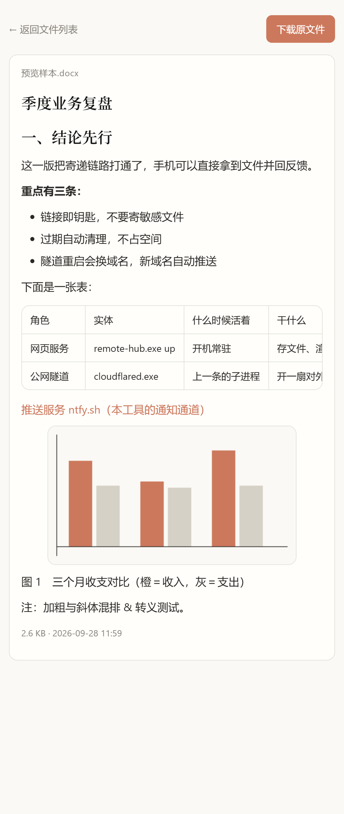
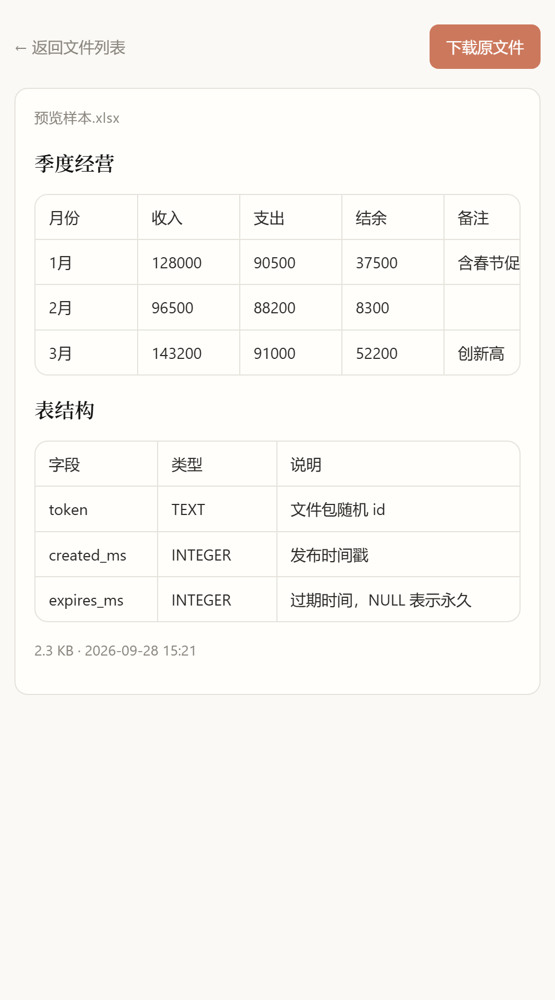
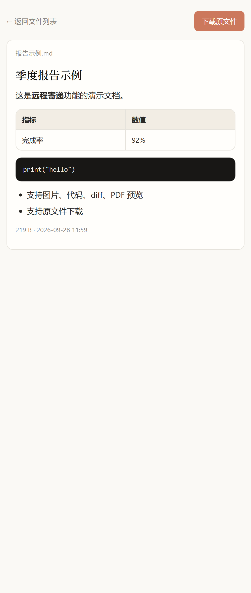
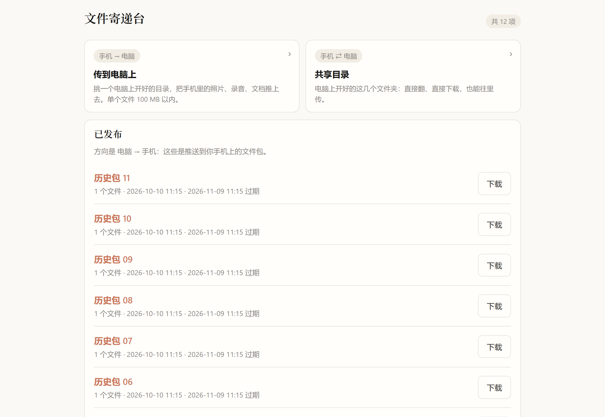
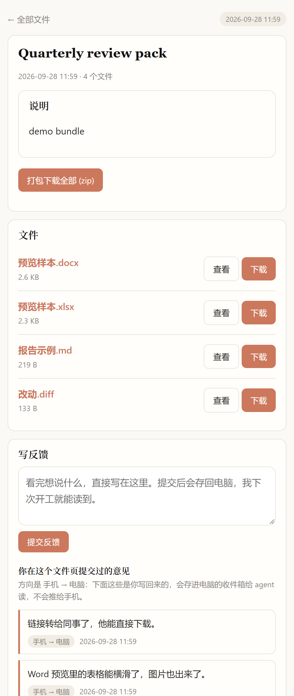

<div align="center">

# postbox

**One sentence from your agent → a link on your phone.**

A self-hosted delivery desk for files an AI agent produces on your computer.
Publish anything, open it on your phone over any network, preview it, forward it,
and send a note back — no cloud drive, no account, nothing stored on a third party.

**English** · [简体中文](README.zh-CN.md)

[**Download**](https://github.com/Heng-CHY/postbox/releases/latest) — Windows · Linux ·
macOS, one binary, no installer, no Rust needed


</div>

---

<table>
<tr>
<td width="33%"></td>
<td width="33%"></td>
<td width="33%"></td>
</tr>
<tr>
<td align="center"><sub><code>.docx</code> with headings, lists, tables and embedded images</sub></td>
<td align="center"><sub><code>.xlsx</code> rendered sheet by sheet, scrollable</sub></td>
<td align="center"><sub>Markdown rendered as a readable page</sub></td>
</tr>
<tr>
<td width="66%" colspan="2"></td>
<td width="34%"></td>
</tr>
<tr>
<td colspan="2" align="center"><sub>Behind <code>/?key=…</code>: the two things you actually do from a phone sit on top; the bundle list (folded past 8) and the inbox follow</sub></td>
<td align="center"><sub>A bundle page on the phone: files, whole-bundle zip, note box</sub></td>
</tr>
</table>

## What it does

You have an agent working on your desktop. It finishes a build, writes a report, produces a
diff — and hands you a path like `D:\work\out\report.md`, useless from a train or a client
meeting. Remote desktop needs a good connection, chat apps need you to drag files around,
cloud drives keep copies on someone else's server. `postbox` is the smallest thing that
closes the loop: one call publishes your files as a link, your phone gets a push, and the
note you type at the bottom of the page lands back in an inbox the agent can read. Open one
folder and the phone can send files the other way too.

| | |
| --- | --- |
| **Publish** | any number of local files as one link (up to 200), plus a whole-bundle zip |
| **Preview** | Markdown, images, PDF, audio, video, code, diffs, `.docx`, `.xlsx/.xls/.ods`, `.csv/.tsv` as tables, indented `.json`, a file listing for `.zip`/`.tar.gz`, and `.html` reports rendered in a script-free sandbox. Media is served with HTTP `Range`, so video starts without the whole file arriving first and the seek bar works |
| **Download / forward** | correct UTF-8 filenames; the link works for anyone, no account, no app |
| **Feedback** | a note box on the page, appended to `data/inbox/feedback.jsonl` |
| **Upload** | the other direction: open a folder with `postbox upload add D:\somewhere` and the phone can push files into it, into a subfolder you name on the spot. Anything over 512 KB is sliced into small chunks and resumed piece by piece; each file is a row with its own pause / resume / cancel / retry |
| **Share** | `postbox share add D:\library` opens a folder both ways: the phone browses it, previews and downloads anything in it with the same renderer as bundles, and uploads back into any subfolder |
| **Expiry** | bundles self-delete (30 days by default, `--days 0` to keep forever) |
| **Agent control** | an MCP stdio server with 5 tools; hardening covered in [SECURITY.md](SECURITY.md) |

Architecture, the code map and building from source: **[docs/architecture.md](docs/architecture.md)**.

## Quick start

Five commands, no toolchain. Download `postbox-windows-x86_64.zip` (or the
[Linux / macOS archive](https://github.com/Heng-CHY/postbox/releases)) — one executable and
nothing else — into a folder you intend to keep, because `data/` is created wherever you run
it:

```powershell
mkdir "$env:USERPROFILE\postbox"; cd "$env:USERPROFILE\postbox"

.\postbox.exe init        # creates data\ with a random access key and ntfy topic
New-Item -ItemType Directory -Force tools | Out-Null
curl.exe -L -o tools\cloudflared.exe https://github.com/cloudflare/cloudflared/releases/latest/download/cloudflared-windows-amd64.exe
.\postbox.exe up          # prints the public URL and pushes it to your phone
.\postbox.exe token       # the home page URL, access key included
```

Keep the `.\` prefix — Windows will not run a program from the current folder without it. On
Linux and macOS use `./postbox`. `cloudflared` is Cloudflare's binary, not ours: one
download, no account, no signup.

On the phone, install [ntfy](https://ntfy.sh) and subscribe to the topic printed by
`postbox config ntfy_topic get`. Then check the whole loop:

```powershell
.\postbox.exe notify-test        # phone buzzes?
.\postbox.exe publish README.md  # link arrives, opens, previews
.\postbox.exe inbox              # your reply shows up here
.\postbox.exe autostart install  # keep it running after login (Windows only)
```

**Want to type `postbox` from any folder?** Run `scripts\win-path.ps1` once: it puts the
binary's folder on your `PATH` and sets `POSTBOX_ROOT` to your data folder — the variable the
command reads instead of `./data` (an explicit `--root` still wins). `-Uninstall` reverses
both. Skip it and just `cd` into that folder first; same result either way. Restart your
editor afterwards: an integrated terminal inherits the editor's own environment, so a new tab
is not a new shell.

**About the access key.** It guards the home page listing only. `init` generates it once, it
sits in `data/config.json` as `access_key`, and it never rotates; the phone remembers it for
30 days. What *does* change on every restart is the hostname, which is exactly why
`postbox token` exists — it prints host and key together. Bundle links (`/b/<token>`) carry
their own unguessable token and need no key, so forwarding one file does not hand over the
whole box.

## Configuration

Everything lives in `data/config.json`. Read or set a value with
`postbox config <key> <value>` (or `get` as the value to print it).

| Key | Default | Meaning |
| --- | --- | --- |
| `port` | `8712` | local HTTP port the server listens on |
| `bind` | `0.0.0.0` | listen address; `0.0.0.0` is what a public tunnel needs, `127.0.0.1` makes it machine-only |
| `access_key` | random UUID | guards the **home page** listing only |
| `base_url` | *(empty)* | public origin; `up` fills it in automatically from the tunnel |
| `tunnel` | `true` | whether `up` also spawns `cloudflared` |
| `ntfy_server` | `https://ntfy.sh` | point at your own ntfy instance if you run one |
| `ntfy_topic` | random UUID | the topic your phone subscribes to; empty disables pushes |
| `cloudflared` | `tools/cloudflared.exe` | path to the tunnel binary, relative to the working dir or absolute |
| `upload_dirs` | *(empty)* | folders the phone may upload into; managed with `postbox upload`, not by hand |
| `share_dirs` | *(empty)* | folders the phone may also browse and download from; managed with `postbox share` |
| `upload_max_mb` | `100` | per-file upload cap. Raising it only pays off off-tunnel: Cloudflare's free plan refuses request bodies over 100 MB whatever the app says |

* `base_url none` clears a stale hostname; `tunnel false` is for a LAN-only setup (then use
  `http://<pc-ip>:8712/?key=…` from your phone).
* Upload targets are never typed by the phone: the page picks one by number out of
  `upload_dirs`, and each entry has to exist and stay off the system drive (`C:` on Windows,
  `/` elsewhere) before it will be accepted. Empty list means the feature is off — no entry
  on the home page, and the API refuses everything.
* `data/` is the whole state of the system. Move it with `--root`, e.g.
  `postbox --root /srv/hub up`, or set `POSTBOX_ROOT` once so the command finds that folder
  from anywhere. Every client that publishes must share one root.
* `port`, `bind` and `tunnel` are read once at startup, so restart `up` after changing them.
  Everything else is re-read from disk, so a new `access_key` or `ntfy_topic` applies
  immediately (the phone still has to resubscribe to a changed topic).
* Values are validated before they are written, so a bad one is rejected rather than
  silently corrupting the config.

## Command line

| Command | What it does |
| --- | --- |
| `init` | create `data/` and a fresh config |
| `serve` | web server only, no tunnel |
| `up` | web server + supervised tunnel, auto-push the hostname |
| `publish <files…> [--title T] [--note N] [--days 30]` | publish one or more files, print the link, push it |
| `inbox [-n 20]` | show feedback submitted from the phone |
| `upload add <dir>` / `upload list` / `upload rm <index\|path>` | open, list or revoke an upload target |
| `share add <dir>` / `share list` / `share rm <index\|path>` | same, for folders the phone may also browse |
| `uploads [-n 20]` | show what the phone has sent in (metadata only — files land where you pointed them) |
| `token` | print the full home page URL, `https://…/?key=<access key>` |
| `config <key> <value\|get>` | read or write one config field |
| `notify-test` | send a test push |
| `autostart install\|uninstall` | Windows login item, hidden window |
| `mcp` | run as an MCP stdio server (for agent clients) |
| `--version` / `-V` | print the version; `--help` lists every flag |

## Wire it into your agent

`postbox mcp` is a stdio MCP server, so any client supporting one can use it, and the config
is the same three lines everywhere:

```json
{
  "mcpServers": {
    "postbox": {
      "command": "/absolute/path/to/postbox",
      "args": ["--root", "/absolute/path/to/postbox-project/data", "mcp"]
    }
  }
}
```

Restart the client, then say *"send the report you just wrote to my phone"*. Where that JSON
goes for each client, what the five tools take, and the caveats worth knowing before you hit
a 404: **[docs/agent-integration.md](docs/agent-integration.md)**.

## Security, briefly

* **The link is the key.** Bundle URLs are random and unguessable, but anyone holding one can
  view and download with no password. Don't publish ID scans, key material or customer lists.
* **Only the home page is protected**, by `access_key`. Individual file pages are not —
  deliberately, since that is what makes forwarding work.
* **The tunnel is public.** One port of your machine is on the internet; assume any page is
  reachable by whoever finds its URL.
* **An agent with `publish_file` can exfiltrate any file on your computer.** Register this
  server only in clients and workspaces you trust.
* **Upload is off until you open a folder.** A target has to exist, be absolute and stay off
  the system drive; the phone picks one by number and never names a path of its own. Names
  are sanitized, an existing file is never overwritten, the body streams to disk under a
  100 MB cap, and the whole route requires `access_key`. Which still means: whoever holds the
  key can write into the folders you opened — `postbox upload rm` them when you are done.
* **A shared folder is a directory listing of your disk**, visible to anyone with the key:
  every file name, size and timestamp below it, and every file's contents on demand. Entries
  whose name starts with a dot never appear and cannot be fetched, and a path that resolves
  outside the opened folder (through `..` or a link someone left there) is refused.
* **Nothing is stored on a third party.** Files stay on your disk; only bytes the phone
  actually requested cross the tunnel, and ntfy carries the link text alone.
* Untrusted documents are parsed, not trusted: CSP + `nosniff` on every response, raw HTML
  and `javascript:` links in Markdown neutralised, and `/raw/`, `/m/` plus the HTML frame at
  `/h/` served under `sandbox` so an uploaded file can run neither script nor a request back
  to the app's own origin.
* Bundles expire and are swept hourly; the feedback inbox is capped at 4 MB.

What is by design, what to report privately, and how to harden further:
**[SECURITY.md](SECURITY.md)**.

## Limitations

* `.doc` (Word 97-2003) is not supported — only the OOXML `.docx` container; legacy files
  fall back to a download prompt.
* Preview caps are deliberate (512 KB of text, 500 rows × 40 columns per sheet, 200 files per
  bundle, and so on). Past a cap you get a download button and an honest message, not a
  truncated page.
* What a browser can decode is still the browser's decision. `.mp4`/`.mov` recorded as HEVC
  (the iPhone default) plays on Android Chrome and stalls on Firefox; sound needs an AAC
  decoder as well, and Firefox on Android decodes the H.264 picture of a clip while staying
  silent — the page names which of the two is missing rather than leaving you to guess.
  `.mkv`, `.avi`, `.wmv` and friends are not offered a player at all; the page says so and
  hands you the download. Single-process serving plus a bandwidth-limited free tunnel: fine
  for documents, slow for a 2 GB video.
* No HTTPS on the local port — TLS terminates at the tunnel.
* Over the free tunnel the wall is **time, not size**, and the time budget moves: Cloudflare
  gives up on a request after roughly 100–170 seconds (HTTP 524), while this machine has seen
  1.5 MB/s on the tunnel one day and 10 KB/s the next (a 1 MB single request then needs 115 s).
  Measured at 1.5 MB/s: 60 MB 3/3 through, 200 MB 3/3 through, 300 MB 0/2 — both died at ~170 s.
  That is why uploads over 512 KB are chunked into 512 KB pieces: each piece is its own request,
  so the tunnel's clock resets every time and a dropped piece is re-sent from where the PC
  actually got to.
  `upload_max_mb` (default 100, max 2048) is the app's own cap. Off Cloudflare the same build
  took 200 MB in 4.0 s and 300 MB in 4.8 s — same Wi-Fi (`http://<pc-ip>:8712/upload`) or
  Tailscale is still the fast lane.
* Free quick tunnels change hostname on every restart, so old links die. Need a stable URL?
  Put the server behind your own domain, a named Cloudflare tunnel or Tailscale and set
  `base_url` yourself — the code does not care where the hostname comes from.
* The web UI **and the CLI output** are Chinese; flags, config keys, comments and docs are
  bilingual. A locale layer is a good first contribution — see
  [`CONTRIBUTING.md`](CONTRIBUTING.md).
* 80 unit tests and CI on three OSes, but no browser automation: what a page looks like on a
  real phone is still checked by hand, which is why the operations doc carries an acceptance
  checklist.

## Related documents

* [Architecture & code map](docs/architecture.md) · [结构与代码](docs/architecture.zh-CN.md)
* [Agent integration](docs/agent-integration.md) · [接入你的 agent](docs/agent-integration.zh-CN.md)
* [Operations & acceptance checklist](docs/operations.md) — which folder to hand to the phone, what to do when an upload crawls, lifecycle table, uninstall, troubleshooting
* [运维与验收清单（简体中文）](docs/operations.zh-CN.md)
* [SECURITY.md](SECURITY.md) — what to report privately, what is by design, how to harden
* [CONTRIBUTING.md](CONTRIBUTING.md) — dev setup, the checks CI runs, rules for previews/UI/docs
* [CHANGELOG.md](CHANGELOG.md) — what changed in each release

## License

[MIT](LICENSE)
